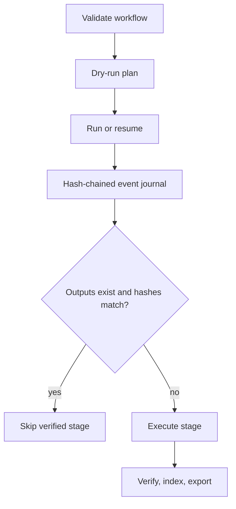

# Automated execution and evidence architecture

## 1. Design goals

The automation layer is deliberately smaller than a general workflow engine.
It provides the properties this study needs: deterministic argv execution,
declared dependencies and outputs, bounded retry/timeout behavior, resumability,
tamper-evident events, per-attempt logs, and no shell-string evaluation.

## 2. Workflow lifecycle



Use `configs/workflow_phase3.template.yaml` as a reviewed starting point:

```bash
traceguard workflow plan \
  --workflow configs/workflow_phase3.template.yaml --work-dir .
traceguard workflow run \
  --workflow configs/workflow_phase3.template.yaml --work-dir .
traceguard workflow resume \
  --workflow configs/workflow_phase3.template.yaml --work-dir .
traceguard workflow status \
  --workflow configs/workflow_phase3.template.yaml --work-dir .
```

`resume` and `run` intentionally share semantics: a completed stage is skipped
only when its prior success record and every declared output digest still
match. Editing an output makes the stage incomplete. A lock prevents two
orchestrators from writing the same journal concurrently; a lock whose holder
PID is dead (hard crash) is taken over and the recovery is journaled, while a
live holder is refused.

Additional resume rules:

- The journal is baselined to the workflow file's SHA-256 (a `genesis` record
  anchors it). Resuming an edited workflow is refused unless the operator
  explicitly re-baselines (`--rebaseline`, journaled as a `rebaselined`
  event) or starts a new work-dir — stale outputs from an old stage command
  are never silently reused.
- A stage with no declared outputs (`outputs: []`) has side effects the
  journal cannot verify, so resume re-runs it unless the operator declared
  it `idempotent: true` (pure-check stages like doctor/verify re-run cheaply;
  declare real outputs for expensive side-effecting stages).

## 3. Failure contract

Failures use stable classes: configuration, input integrity, model admission,
resource exhaustion, transient provider, data quality, statistical gate,
software defect, cancellation, and unknown. Every failure includes the stage,
exception type, retryability decision, attempt, and log path. Retries are
bounded in the workflow file. Scientific gate failures are not transient and
must never be retried into a pass by changing the threshold or data.

Exit-code convention: `0` success; `1` generic failure; `2` CLI usage error;
`3` statistical-gate failure (`traceguard.errors.GATE_FAILURE_EXIT_CODE`).
Stage commands that evaluate predeclared gates (`scripts/pilot_gate.py`,
`scripts/monitor_gate.py`) exit 3 on failure; the workflow engine classifies
exit 3 — or any failure of a `gate: true` stage — as `statistical_gate` and
never retries it (gate stages must declare `retries: 0` and may not set
`continue_on_error`). The CLI exits 3 when a workflow stops on a statistical
gate failure. Retryability is layered: engine-detected failures retry only
for inherently retryable classes (resource exhaustion, transient provider);
stage exit-code verdicts follow the operator-declared per-stage `retries`;
`statistical_gate` and `user_cancelled` are never retried. Every journal read
re-verifies the hash chain and the durable anchor (`journal_state.json`), so
tail truncation is a loud tamper error, and operator-facing failures surface
as structured failure envelopes — tracebacks only in logs.

## 4. Run directory contract

| Directory | Authority | Required content |
|---|---|---|
| `episodes/` | monitor-visible | exact projected events and trace boundaries |
| `privileged/` | ground truth/audit | raw prompts, outputs, token IDs, states, transitions |
| `transactions/` | recovery | write-ahead envelope + privileged pair |
| `commits/` | recovery | transaction digest and projection digests |
| `monitor_scores/` | measurement | prompts, raw responses, parse result, view hash, timing |
| `reports/` | derived | analysis report and plot data |
| `logs/` | operations | per-stage/attempt stdout and diagnostics |
| `artifacts/` | integrity | release manifest, evidence index, checksum ledger |

The evidence index assigns every file a role, media type, size, and SHA-256,
then hashes the ordered inventory. Its derivation contract distinguishes
ground truth, monitor input, measurement, and derived outputs. `verify` checks
the index when present; `export` rebuilds it before final checksums.

## 5. Figures and tables

Analysis emits plot data as JSON next to each figure. Every figure is rendered
as PNG for review, SVG for editable publication graphics, and PDF for archival
use. The standard set contains ROC, precision-recall, score distribution,
paired-effect forest, capability funnel, and measurement completeness views. A
provenance footer links run ID and config digest.

## 6. Validation tiers

- Tier 0: config/schema parsing and `doctor`.
- Tier 1: pure metric fixtures, property tests, journal tamper tests.
- Tier 2: deterministic CPU smoke, re-grade, view leakage, resume behavior.
- Tier 3: model admission on the exact GPU/runtime and exact checkpoint.
- Tier 4: exploratory pilot with every gate and raw artifact retained.
- Tier 5: preregistration freeze, clean confirmatory generation, blind analysis.

The CI workflow runs Tier 0–2 on Python 3.11 and 3.13. GPU admission and real
model evaluation cannot be represented by a green CPU CI badge and stay
separate blocking artifacts.

